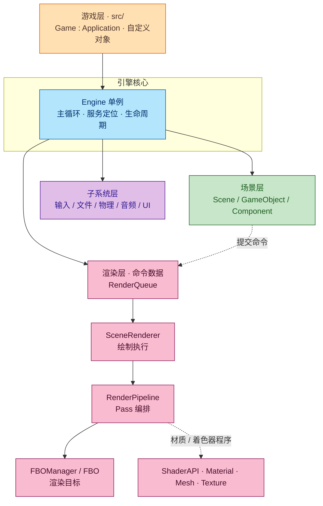

# OpenGL 3.3 游戏引擎 + 演示游戏

GL_Engine 是一个个人自研的游戏引擎，**支持3D/2D小型游戏开发**。基于【**C++17 + OpenGL 3.3 core**】构建，目标是搭建一个能完整跑通“渲染-物理-音频-UI-场景”游戏开发链路的引擎。引擎以库（EngineDemo）的形式提供，游戏层（GameDemo）仅通过Application生命周期与引擎交互，验证引擎的功能完整性。

> 主菜单


> 演示场景


## 特性

- **渲染：**管线式渲染（RenderQueue 接收数据命令，SceneRenderer 负责渲染，RenderPipeline 负责管理 Pass 并按 Pass 类型调用 SceneRenderer 渲染。数据驱动 FBO 创建，演示 Demo 预设阴影贴图、SSAO、天空盒、Bloom 后处理以验证渲染管线。
- **场景：**数据驱动场景构建，.sc 管理 Scene / GameObject / Component（场景/游戏对象/对象组件）的构建，.mat 管理各个 GameObject（游戏对象）的材质与着色器变体集，集成 cgltf 库以支持 glTF 模型导入
- **物理：**Bullet3 固定步长模拟，提供刚体物理模拟、碰撞检测，借此实现了角色控制、跳跃平台、碰撞按钮与动态箱体等。
- **音频：**miniaudio 封装实现音频数据解码与播放，通过 audio 与 audioListener 组件绑定 GameObject 可设定音频播放与接收
- **UI：**FreeType 库实现字体解析与字形栅格化，结合 Canvas / Button / Text 实现简易 UI。
- **工程：**依赖全部源码内嵌，无需外部安装，一键构建。


## 构建与运行

> 要求：Windows 10 + MinGW-w64（GCC）+ CMake ≥ 3.15

``````
cmake -S . -B build -G "MinGW Makefiles" -DCMAKE_BUILD_TYPE=Debug
cmake --build build
./bin/GameDemo.exe
``````


## 操作

点击 Play 按钮进入游戏，W / A / S / D 移动、空格跳跃、鼠标移动视角、左键射击（有 1 秒的内置射击冷却）；Esc 可从游戏内退回到主菜单；点击 Quit 按钮退出程序。


## 架构速览



`src/game.h`中定义的 Game 为 Application 子类，在`AppInit()`函数中调用 Engine 单例，通过 Engine 单例调用引擎场景加载来设定游戏场景，并可以用引擎提供的各个子系统层设定游戏玩法。

在`AppInit`中还可以使用 RenderPipeline 自定义渲染管线，通过场景层提交的 RenderQueue 命令数据与 Component 组件系统每帧提交的 RenderCommand 通过各个渲染 Pass 后调用 SceneRenderer 渲染输出到 FBO 或者直接渲染到屏幕。

